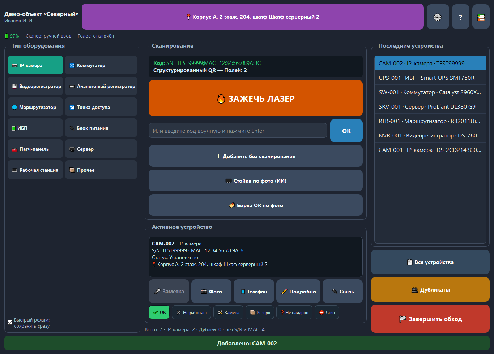
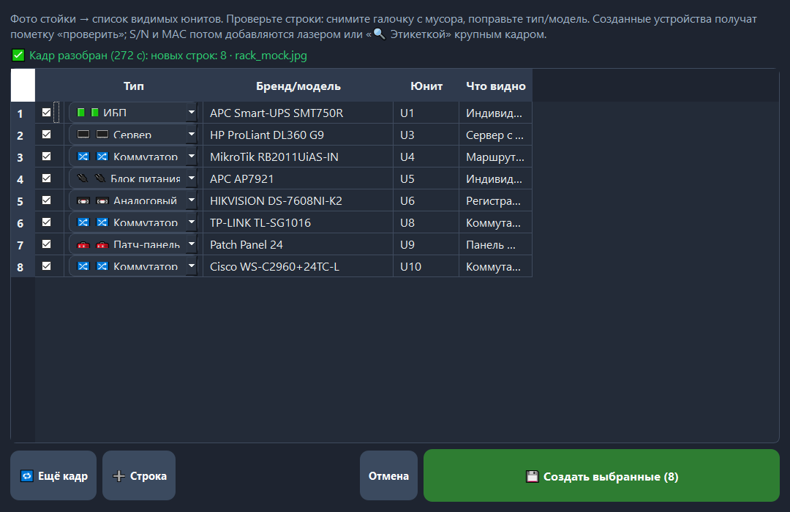
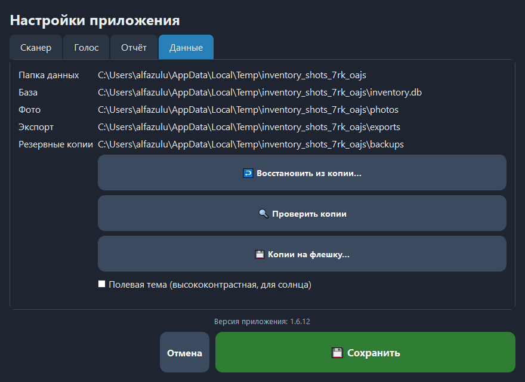
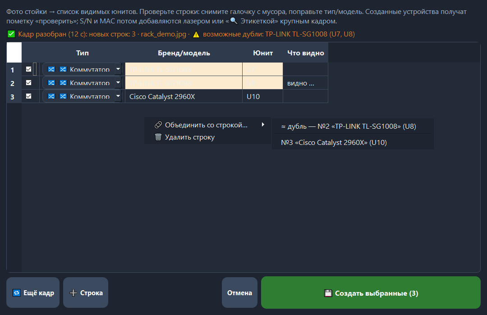

# Инвентаризация объекта — новая версия (Getac V110)

Офлайн-приложение для полевой инвентаризации камер, коммутаторов, регистраторов
и прочего оборудования. Сканер штрихкодов + голосовые заметки + фото + Excel-отчёт.
С v1.5.0 — разбор фото этикетки с телефона (штрихкод/S/N, MAC, модель) и
полная база производителей по MAC (IEEE OUI, ~40 000 префиксов).
С v1.6.0 — «🖥 Стойка»: фото серверной стойки → черновой список видимых юнитов
по локальному ИИ (ollama, офлайн) → создание устройств пачкой одним кадром.
С v1.6.4 — «🏷 Бирки QR»: печать QR-этикеток «SN=…;MAC=…» в PDF-A4 (24 этикетки
65×35 мм на лист) — скан бирки при повторном выезде находит карточку мгновенно,
без фото-разбора этикетки.
С v1.6.5 — бирки и для безымянного оборудования: устройству без S/N и MAC
присваивается инвентарный номер «INV-####» (глобальный реестр), QR кодирует
«INV=…» и скан бирки находит карточку; печать выбором галочками; PNG одной
бирки для перепечатки.
С v1.6.7 — печатный акт и чек-лист докрутки в окне завершения, скан QR-бирки
по фото кадра, горячие клавиши S/V/F, автосохранение черновика стойки,
SHA-256-манифест резервных копий, лист «Фото» с миниатюрами в Excel и
экран «Справочник» с полевыми шпаргалками.
С v1.6.8 — сетевая автопроверка «🌐 Сеть» в карточке (ping + сверка MAC
по ARP: сразу видно «записан, но не отвечает» или «IP переехал на другую
коробку»), слияние мульти-кадров стойки без дублей юнитов, полевая
высококонтрастная тема для солнца (Настройки → Данные) и CI на GitHub
Actions (ruff + pytest на каждый пуш).
С v1.6.9 — ревизия сети сессии («🌐 Ревизия сети» в списке устройств:
пачка ping+ARP по всем IP, перед выездом видно, кто не отвечает),
восстановление базы из копии кнопкой в Настройках (FR-60 закрыт,
вручную переименовывать файлы не нужно) и фильтр по локации в списке
устройств (FR-63 закрыт).
С v1.6.10 — TCP-пробы RTSP/HTTP в сетевой проверке («жива, но поток
не отдаёт» видно сразу), автовосстановление при битой базе на старте
(приложение само предложит копию и продолжит работу) и фиксация
ревизии сети в отчёте: лист «Сеть» в Excel с датами, статусами
и портами.
С v1.6.11 — подсветка возможных дублей в черновике стойки (одна и та
же коробка на двух позициях — жёлтая строка и сводка в статусе) и
кнопка «🔍 Проверить копии» в Настройках: целостность резервных копий
по SHA-256-манифесту видно из UI.
С v1.6.12 — «💾 Копии на флешку» в Настройках → Данные: резервные копии
базы уезжают на съёмный диск с перепроверкой SHA-256 на месте записи
(страховка на восстановление больше не живёт только на V110), и правый
клик по строке стойки: «🔗 Объединить со строкой…» (дубли из подсветки
сливаются вручную — лишняя строка удаляется, пустые поля приёмника
заполняются) и «🗑 Удалить строку».
С v1.6.13 — QR-метки TIA-606 переключают локацию сканом, лист наклеек
получил контроль масштаба (линейка 100 мм, метки реза), дубли меток
по умолчанию не печатаются, фото стойки можно снять телефоном прямо
в открытый разбор, а `prompt_lab` умеет повторы с seed и сводку разброса.

## Скриншоты

| | |
|---|---|
| **Экран обхода**: типы в один клик, сканирование, активная карточка, последние устройства | **«Стойка по фото (ИИ)»**: черновик юнитов с фото, галочки и правка типа/модели перед созданием пачкой |
|  |  |
| **Настройки → Данные**: папки, восстановление/проверка копий и «Копии на флешку» (v1.6.12) | **Дубли и правый клик**: жёлтая подсветка сомнительных строк, «Объединить со строкой…» («≈ дубль» первым), «Удалить строку» |
|  |  |

---

## Что здесь есть

| Вариант | Как запустить | Что это |
| --- | --- | --- |
| **Новая версия (основная)** | `run_inventory.bat` или `python run_inventory.py` | Пакет `inventory/`, SQLite, предстартовая проверка, экспорт Excel |
| Старый прототип (запасной) | `python main.py` | Файлы `main.py`, `gui.py`, `database.py`. Работает, ничего не удалялось |

## Установка

Python 3.11+ (на ноутбуке — 3.13). Установка зависимостей:

```bat
python -m pip install -r requirements.txt
```

## Запуск

- Двойной клик `run_inventory.bat` — откроется на весь экран.
- Или в терминале: `python run_inventory.py`, либо `python -m inventory.app`.

Настройки хранятся в `config.json` (создаётся автоматически при первом запуске).

## Сборка exe для ноутбука

```bat
python tools\build_exe.py              # onefile: один exe
python tools\build_exe.py --onedir     # папка: мгновенный старт
```

Результат — папка `release\` (onefile-режим):

```
InventorySurvey.exe   приложение (один файл, PyQt6/vosk/OpenCV внутри)
model\                голосовая модель Vosk (для заметок)
ПРОЧТИ_МЕНЯ.txt       краткая инструкция
getac_inventory.zip   всё вместе, архив для переноса на ноутбук
```

В режиме `--onedir` exe публикуется папкой `InventorySurvey\` (+ архив
`getac_inventory_onedir.zip`); старт мгновенный — файлы уже распакованы,
при этом оба zip-архива сохраняются рядом, если собрать оба режима подряд.
Версия сборки — в файле `inventory\config.py` (`APP_VERSION`); она видна
в заголовке окна, в настройках и в `ПРОЧТИ_МЕНЯ.txt`.

Папку из архива распаковать на ноутбук и запустить `InventorySurvey.exe`.
Все данные (`config.json`, `data\`) создаются рядом с exe, в portable-режиме.
Самотест офлайн-запуска exe входит в сборку; флаги: `--skip-build`, `--no-model`,
`--skip-selftest`, `--no-zip`.

## Инструменты (папка tools)

| Скрипт | Что делает |
|---|---|
| `build_exe.py` | сборка exe + самотест + архивы (см. выше) |
| `make_demo.py` | наполнение базы демо-данными (репетиция сценария) |
| `rehearsal_check.py` | сверка цифр офисной репетиции (РЕПЕТИЦИЯ.md) |
| `check_ollama.bat` | проверка ollama на выездном ноутбуке (ASCII, двойной клик) |
| `prepare_flash.bat` | заливка флешки выезда одной командой: полевая модель qwen2.5vl:7b (без лишних из библиотеки), сборка, полевые скрипты, установщик — каждая копия сверяется SHA-256 |
| `deploy_7b_v110.bat` | развёртывание модели qwen2.5vl:7b прямо на машине с интернетом: скачает GGUF с HuggingFace, сверит SHA-256, соберёт через `ollama create`; докачка после обрыва, `-KeepFiles` оставляет файлы |
| `backup_data.bat` | копия `data\` на флешку одной командой (robocopy); с v1.6.12 есть и кнопка «💾 Копии на флешку» в Настройках — копии базы с перепроверкой SHA-256 на флешке |
| `backup_loop.bat` | то же каждые N минут весь день (страховка от урона ноутбука) |
| `make_rack_mock.py` | синтетический макет стойки 10U (8 юнитов) |
| `make_bench_set.py` | бенчмарк: тёмный/блики/обрезка/плотная 15U + эталон `bench/expected.json` |
| `debrief_report.py` | печатный разбор журнала `rack_ai_log.jsonl`; `--expected` сверяет кадры бенчмарка с эталоном (точно/частично/пропущено) |
| `prompt_lab.py` | A/B-стенд промпта: подмена `_PROMPT` в памяти, полный конвейер, автооценка счётчиком; `--repeat/--seed/--out` — серия повторов и воспроизводимость |
| `lab_repeats.py` | сводка повторов `prompt_lab`: по кадру n прогонов, средняя полнота, min–max и счётчики — свойство промпта или шум модели |
| `export_netbox.py` | экспорт в NetBox: 7 CSV в порядке bulk-import + полный JSON; позиция из «В стойке: U5-U8», статусы по смыслу |
| `tia606.py` | метки TIA-606-C для стоек и портов: генератор с транслитом, строгий валидатор, `labels.csv` + `labels.pdf`; `--ports`, `--allow-duplicates`, `--preview` |
| `labels_pdf.py` | печатный лист наклеек из `labels.csv`: A4, 24 шт. 65×35 мм, QR `TIA=…`, автоподбор кегля, линейка 100 мм и метки реза |
| `ui_screenshots.py` | скриншот-тур README: снимки окон без ручного GUI |
| ui_*_smoke.py, ui_final_check.py, probe_scanner.py | смоуки интерфейса, финальная проверка, зонд сканера |

Бенчмарк — измерительный прибор для правок промпта: после каждой правки
`rack_ai.py` прогонять `python -X utf8 tools/prompt_lab.py` (полный конвейер
+ автооценка) и сравнивать с базой. База v1.6.2: полнота 65% (18/17/6 на
5 кадрах). В v1.6.3 промпт-лаба выбрала «combo» (анти-повтор + 2U-диапазоны
+ типы по форме): 72% (пропуски 6→1, лишние строки 0, цикл повторения на
плотной стойке убит) — результат одного прогона, полевые данные пятницы
его уточнят. Паритет промпта приложения и лабы держит тест
`test_prompt_matches_prompt_lab_combo`.

На полевой 7b (18.11, все 5 кадров): `ranges` — 78% (25/14/2),
`anti_repeat` — 71% (20/18/3/1), `types` — 70% (22/13/6), `combo` — 66%
(19/16/6, лишних 0). На плотной 15U `combo` лучший — 11/2/0 и ноль
выдуманных строк; но на мелких кадрах его отставание устойчивое:
три прогона дали 54–61%, `mock`/`partial` повторяются кадр в кадр,
`dark`/`glare` гуляют (56–75% и 50–56%). `ranges` на тех же четырёх
кадрах повторился ровно — 75% (78% с плотной) — и остаётся кандидатом
на следующий пакет. Сейчас полевой промпт — `combo` (решение по смене —
после реальных кадров), 7b выбран по тестам 17.11 (читает бренды);
артефакты повторов — рядом, `*_rep1/rep2.json`.

Повторы и разброс (v1.6.13): `python -X utf8 tools\prompt_lab.py --variant
combo --frame rack_dark --repeat 3 --seed 42 --out data\exports\lab.json`,
затем `python -X utf8 tools\lab_repeats.py --json data\exports\summary.json`.
`--seed` фиксирует зерно ollama (проверка воспроизводимости), `--repeat`
помечает строки номером повтора, `lab_repeats` сводит по кадру n прогонов,
среднюю полноту и min–max. Это и отличает свойство промпта от шума модели:
кадр, который повторяется 2/4/2 каждый раз, — не случайность.

Проверка seed 19.11 (7b, `combo`, `rack_dark`, seed 42, 2 повтора):
оба прогона дали ровно 3 точно / 3 частично / 2 пропуска (56%) — при
фиксированном зерне результат воспроизводится. Сводка по всем прогонам
`combo`/`rack_dark` без фиксации seed: 5 прогонов, 64% (56–75%) —
разброс между запусками и есть тот шум, который снимает серия повторов.

### NetBox и метки TIA-606

Экспорт в NetBox — `python -X utf8 tools\export_netbox.py`: семь CSV
в порядке bulk-import (sites → locations → racks → roles → manufacturers →
device_types → devices) плюс полный `netbox.json` в `data\exports\netbox\`.
Позиция устройства берётся из пометки «В стойке: U5-U8» (нижний юнит —
как в NetBox), статусы переводятся по смыслу; импорт — по одному файлу
в том же порядке.

Метки для наклеек — `python -X utf8 tools\tia606.py`: из базы собирается
`data\exports\tia606\labels.csv` со схемой `<ОБЪЕКТ>-<ПОМЕЩЕНИЕ>-<СТОЙКА>`
(для портов — `<...>-<ПАНЕЛЬ>-<ПОРТ>`). Кириллица транслитерируется,
сегменты — только A-Z 0-9, лимиты 8/12/8/8/4 символа; полные имена
остаются в БД и NetBox. Схема заморожена: уже распечатанные наклейки
не должны разойтись с новыми. **Дубли меток по умолчанию не печатаются**
(две одинаковые наклейки на разные стойки хуже, чем ни одной): в отчёте
будет предупреждение, осознанно оставить дубль — `--allow-duplicates`.
Порты добавляются подготовленным CSV `site,room,rack,panel,port`:
`--ports data\ports.csv` (метки портов идут после стоек, с натуральной
сортировкой «Ш-2» → «Ш-10»). Проверить готовую метку:
`python -X utf8 tools\tia606.py --check "A-101-SH1"`.

QR на наклейке кодирует `TIA=<метка>` — не S/N и не MAC. В приложении
сканер (или «🏷 Бирка QR по фото») читает такую метку и **переключает
текущую локацию** на стойку с этой меткой; если метка не найдена среди
локаций сессии или совпала с несколькими — приложение честно скажет,
а не выберет молча.

Печать наклеек — `python -X utf8 tools\tia606.py --db data\inventory.db --pdf`
→ `labels.csv` и `labels.pdf` (A4, 24 наклейки 65×35 мм, как QR-бирки).
На каждом листе — линейка 100 мм и метки реза: если линейка не совпала
с настоящей, принтер растянул PDF и 65×35 мм уже не те. Проверить вид
без печати: `--preview` (PNG первой страницы), отфильтровать объект или
помещение: `--site "Корпус А"` / `--room 101`, напечатать без QR:
`--no-qr`. Для готового CSV отдельно: `python -X utf8 tools\labels_pdf.py
--csv <файл>`. В диалоге печати выбирайте «Фактический размер / 100%»,
иначе 65×35 мм поедут и не совпадут с ножом.

## Данные (всё рядом с программой)

```
data\
  inventory.db   база SQLite (WAL) — вся инвентаризация
  photos\        фото устройств
  exports\       Excel-отчёты
  backups\       автоматические копии базы (держится 30 шт.)
  logs\          app.log + crash-файлы при аварийных завершениях
```

База и версии: новая сборка, открывая базу, созданную прежней версией,
сама дорождает недостающие колонки (ступенчатые миграции в `db.py`,
счётчик `schema_version`) — перенос данных между версиями не требует
ручных действий. Базу, созданную *более новой* версией, старая сборка
не примет и сообщит об этом (защита от затирания).

При аварийном закрытии приложения создаётся `data\logs\crash-<дата>.txt`;
при следующем запуске программа сама предложит открыть разбор.

Старая таблица `getac_ai_inventory.xlsx` не трогается и продолжает использоваться
старым прототипом.

## Что делает новая версия

1. **Старт сессии**: объект, инспектор, подрядчик, предстартовая проверка
   (батарея, диск, база, папка экспорта, модель Vosk, микрофон, сканер, камера,
   дата/время). Начать можно даже с предупреждениями, красная ошибка блокирует.
   Подрядчик выбирается из списка прошлых (или вводится новый) — запоминается
   в сессии и попадает в титульный лист Excel.
2. **Экран обхода**: тип устройства слева, локация сверху, сканирование в центре.
   Кнопки «＋ Добавить без сканирования» и «🖥 Стойка по фото (ИИ)» (v1.6.0) —
   создание устройств без кода, стопкой по списку или пачкой с фото стойки.
   Быстрый режим — скан и мгновенное сохранение; полный — карточка с индустриальными
   полями (S/N, MAC, IP, модель, питание, статус, связь, фото, заметки).
   Горячие клавиши (v1.6.7): **S** — триггер лазера, **V** — голосовая заметка,
   **F** — фото (Ctrl-сочетания не трогаются). Кнопка «🏷 Бирка QR по фото»
   (v1.6.7) — распознать напечатанную QR-бирку с кадра камеры или с файла,
   когда лазером дотянуться нельзя. Кнопка «📚» — экран «Справочник».
3. **Сканер ШК**: режимы COM (порт/скорость настраиваются), HID (клавиатура с буфером
   и защитой от повтора), ручной ввод. Локальный парсер распознаёт: MAC (разделители
   и слитно), S/N, EAN, IP, структурированный QR (SN=…;MAC=…;IP=…, JSON, URL).
4. **Дубли**: сверка по S/N и MAC до сохранения; EAN дублем устройства не считается.
   Кнопка «👥 Дубликаты» на экране обхода показывает все подозрительные пары
   сессии одним списком (счётчик прямо на кнопке), из списка — сразу в карточку.
5. **Голос**: офлайн-распознавание Vosk с полевым словарём (камутатор → коммутатор),
   заметка прикрепляется к активному устройству. Модель грузится в фоне несколько
   секунд (первый запуск копирует её в ASCII-каталог
   `%LOCALAPPDATA%\GetacInventory\vosk_model` — Vosk на Windows не открывает модель
   по пути с кириллицей; копия обновляется автоматически при смене папки проекта).
6. **Фото**: камера ноутбука (OpenCV) и телефон по Wi-Fi (стр. «📱 Телефон»).
   В диалоге фото есть кнопка «📁 Из файла» — прикрепить готовый снимок с диска
   (например, пересланный с телефона). Фото с телефона привязываются к устройству,
   выбранному в момент прихода снимка. На одно устройство можно несколько снимков
   (общий план + этикетка): последний показывается миниатюрой в карточке,
   в Excel уходит список.
   **Фото этикетки распознаётся** (v1.5.0): в карточке кнопка «🔍 Этикетка» снимает
   фото и разбирает его; снимок, пришедший с телефона без активного устройства,
   тоже разбирается — приложение предложит создать устройство с готовыми
   S/N, MAC и моделью (см. раздел «Инвентаризация по фото этикетки»).
7. **Экспорт Excel**: листы «Титул» (шапка с итогами для заказчика), «Устройства», «Связи», «Регистраторы» (если есть каналы),
   «Стойки» (v1.6.6: раскладка по шкафам и юнитам, U1 → вверх; если у
   локаций заполнен шкаф), «Сводка», «Сверка» (если выбрана прошлая
   таблица), «Проблемы», «Фото» (v1.6.7: миниатюры снимков прямо в таблице
   и кликабельные ссылки на оригиналы). Файл в `data\exports\`, посессийно; повторный
   экспорт — «История сессий» → выбор сессии → «Экспорт Excel». В «Истории
   сессий» есть также «▶ Продолжить (добавить устройства)» — завершённый
   проект открывается снова и принимает новые устройства (двойной клик по
   строке — то же самое; активная сессия при этом остаётся только одна:
   приложение запросит завершить другую).
8. **Канал NVR**: для камеры на регистраторе в карточке (вкладка «Связь») указывается
   «Канал NVR» (D1…D16 / 1…32) или связь «Подключено к» регистратору с портом-каналом.
   В Excel собирается лист «Регистраторы» — карта каналов по каждому регистратору.
9. **Сверка с прошлой инвентаризацией**: в окне завершения кнопка
   «🗂 Сверить с прошлой таблицей…» читает старый Excel и сравнивает по S/N и MAC:
   что совпало, что изменилось (модель/IP/локация), что новое, а чего из прошлого
   списка не нашлось. Сопоставление — как в проверке дублей.
   Там же «🗄 Из архива сессий…»: сравнение с завершённой сессией этой же базы —
   для регулярных обходов своего объекта файл Excel вообще не нужен.
   Там же (v1.6.7) «📄 Акт PDF» — печатный акт по итогам (шапка, таблица
   устройств, подписи, перенос страниц) и «✅ Чек-лист докрутки» — по каждому
   устройству, что осталось добрать (нет S/N/MAC, нет связи, нет фото,
   не проверено).
10. **Резервные копии базы** автоматически при старте сессии, экспорте и завершении;
    каждая копия регистрируется в SHA-256-манифесте `data\backups\manifest.json`
    (v1.6.7) — по нему видно, если файл побит, подменён или пропал;
    журнал работы и разбор падений — в `data\logs\`.
11. **Импорт сессии из другой базы** (обход вдвоём, два ноутбука): на стартовом
    экране кнопка «⤵ Импорт из базы…». Напарник приносит свою базу
    (`data\inventory.db`) и папку `data\photos`; устройства переносятся с новыми
    номерами CAM-xxx/SW-xxx, локации сопоставляются по «корпус/этаж/помещение»,
    фото копируются вместе с привязками, журнал сканов объединяется.
    Совпадения по S/N или MAC разбираются выбранным режимом: пропустить /
    добавить как новые (пара уйдёт в «Дубликаты») / заполнить пустые поля
    существующих записей. Повторный импорт копий не создаёт.
12. **Финальные удобства**:
    - **Чипы статуса** под активной карточкой («✔ ОК», «✖ Не работает», «🛠 Замена»,
      «📦 Резерв», «❓ Не найдено», «⛔ Снят») — статус в один клик, без «Подробно»;
    - **Производитель по MAC**: полная офлайн-база IEEE OUI (~40 000 префиксов,
      из `inventory/data/oui.csv`, грузится в фоне при старте) + привычная
      мини-таблица вендоров видеонаблюдения (Hikvision, Dahua, Cisco,
      TP-LINK, Ubiquiti...) — поле заполняется само, ручной ввод главнее;
    - **Шапка титула**: подрядчик берётся из сессии (выбирается на старте);
      «Настройки → Отчёт» — организация по умолчанию и номер договора
      (используются, когда в сессии подрядчик не указан).
    - **Кнопка «?»** на экране обхода — шпаргалка в поле (лазер, фото, голос,
      дубликаты, что делать при проблемах).
    - **Экран «Справочник»** (v1.6.7, кнопка «📚» в обходе/старте/справке) —
      три вкладки: S/N и MAC по вендорам; кабели и PoE; стойки и юниты.
    - **Черновик стойки не теряется** (v1.6.7): правки таблицы юнитов
      автосохраняются, при повторном открытии диалога — «Восстановить?».

## Фотографии с телефона (труднодоступные места)

1. На экране обхода кнопка «📱 Телефон» — окно с адресом и QR-кодом.
   Сервер приёма стартует автоматически вместе с сессией (порт 8790, если занят — ищет свободный рядом).
2. Телефон и ноутбук — в одной Wi-Fi-сети, без интернета:
   - проще всего **хот-спот на ноутбуке**: Windows «Сеть → Мобильный хот-спот» (ноутбук-точка = 192.168.137.1);
   - либо **хот-спот телефона**, и ноутбук подключается к нему по Wi-Fi.
3. Камерой телефона сканируйте QR — откроется страница с двумя кнопками:
   «📸 Снять фото» (камера телефона: видно и снято прямо с рук) и
   «🖼 Из галереи» (если снимок сделан раньше — например, камера на мачте вне
   зоны Wi-Fi: сфотографировали вдали, принесли телефон в зону и отправили).
4. Каждое фото сохраняется в `data\photos` и привязывается к активному устройству
   главного экрана (в Excel-отчёте — путь к файлу). Журнал приёма — в том же окне.
5. **Фото стойки с телефона** (v1.6.13): в диалоге «🖥 Стойка» кнопка
   «📱 С телефона» открывает тот же QR. Пока разбор стойки открыт, сервер
   работает в режиме «стойка»: снимок с телефона сразу уходит в ИИ-разбор
   (страница телефона так и пишет), перекидывать файл через мессенджеры
   не нужно. Если разбор уже закрыли — фото остаётся в `data\photos`,
   приложение честно предупредит, что привязывать его некуда.
6. Доступ защищён токеном в адресе (меняется при каждом запуске сессии) — случайные
   телефоны сети не смогут ничего отправить.

Зависимость: `qrcode>=7.4` (в requirements.txt; в exe-сборку добавляется автоматически).
Если пакет qrcode не установлен — приложение работает, QR заменяется текстовым адресом.

## Инвентаризация по фото этикетки (v1.5.0)

Устройства без сканируемого кода или с грязной этикеткой можно вносить по фотографии:

**Сценарий 1 — в карточке устройства.** Вкладка «Заметка и фото» → кнопка
«🔍 Этикетка». Покажет стандартный диалог фото (камера ноутбука / 📁 Из файла —
можно просто переслать снимок с телефона). После снимка приложение 2–5 секунд
разбирает этикетку и заполняет пустые поля: S/N, MAC, модель, IP; вендор по MAC
подставляется автоматически (полная база IEEE). Заполненные вручную поля
не трогаются.

**Сценарий 2 — прямо с телефона.** Пришедшее по Wi-Fi фото, когда активного
устройства нет, разбирается так же: приложению будет предложено «Создать
устройство по фото?» — откроется карточка с заполненными полями и прикреплённым
фото. Прежнее поведение (сохранить как `no-device_*.jpg`) сохранено для снимков,
где этикетку распознать не удалось.

Как это работает и что ожидают от снимка:
- автоматический поиск светлой этикетки в кадре; поворот и несколько масштабов
  (встроенный OCR Windows ограничен ~5000 px);
- распознавание двумя языками (en-US + ru) и чтение штрихкодов
  (CODE128/CODE39/EAN/QR) самим OCR и libzbar;
- результат всегда «кандидаты»: OCR может путать O/0, I/1, E/В — значения
  показываются в диалоге и заполняются в поля как черновик, исправьте вручную;
- реальные прогоны (фото D-Link DES-1210 в `Polevoj test/`): S/N прочитан
  из штрихкода CODE39, MAC распознан с точностью до одного символа
  (пользователь поправил), модель — мелким кеглем, лучше вводить вручную;
- снимайте этикетку крупно: этикетка должна занимать кадр целиком, без бликов
  и без резкого угла; расстояние «макро» телефона, автофокус по этикетке;
- если разбор недоступен (в exe конвейер всегда установлен; признак — погашенная
  кнопка), данные вносятся вручную.

Зависимости разбора: `pyzbar` (штрихкоды, libzbar в комплекте) и пакеты
`winrt-*` (встроенный OCR Windows; язык OCR en-US/ru должен быть в системе —
в Windows 10/11 есть по умолчанию). Всё офлайн-и-локально.

## Стойка по одному фото — «🖥 Стойка» (v1.6.0)

Серверную стойку/телеком-шкаф можно вносить не юнит за юнитом, а одним кадром:
кнопка **«🖥 Стойка по фото (ИИ)»** на экране обхода (рядом с «＋ Добавить
без сканирования»).

Как это работает:
1. Камера ноутбука, 📁 Из файла (можно кадр с телефона) или **«📱 С телефона»**
   (v1.6.13 — QR, снимок сразу в разбор). Локальный ИИ — **ollama** с
   vision-моделью (по умолчанию `qwen2.5vl:3b`), работающий на этом же
   ноутбуке, — перечисляет **видимые юниты**: тип, бренд/модель,
   позицию («U5»), описание.
2. Результат открывается редактируемой таблицей: снимите галочку с мусора,
   поправьте тип и название, добавьте пропущенные кнопкой «➕ Строка».
   Второй кадр («🔁 Ещё кадр») пополняет список, не дублируя уже вписанные.
   Правый клик по строке: **«🔗 Объединить со строкой…»** (дубли из
   подсветки — лишняя строка уходит в приёмник: пустые поля заполняются,
   заполненные остаются; дубли в меню идут первыми, с пометкой «≈») и
   **«🗑 Удалить строку»**.
3. «💾 Создать выбранные (N)» — устройства создаются пачкой в текущей локации
   с пометкой `is_verified=False` и заметкой «Создано по фото стойки
   (ИИ-черновик) — проверить». Активным становится последнее созданное.

Честные границы и советы в поле:
- **S/N и MAC с фото стойки не читаются** — это физика, а не ИИ: расстояние
  не позволяет. Детали добираются после: лазером, ручным вводом или
  «🔍 Этикеткой» крупным кадром у каждого юнита.
- ИИ может пропустить юнит или прочитать бренд неверно — считать черновик
  истиной нельзя, галочка «Создать» = ваше подтверждение.
- На CPU (встроенная графика V110) один кадр разбирается **1–3 минут**;
  для ~10 юнитов это быстрее, чем добавить каждый вручную.
- Снимайте стойку целиком, при свете, без бликов; стойку выше ~25 юнитов
  лучше разбить на 2–3 кадра (верх/середина/низ).
- Условие: на ноутбуке установлена ollama (отдельная программа, это не
  `pip install`) и скачана vision-модель — полевая `ollama pull qwen2.5vl:7b`
  (~6 ГБ, тесты 17.11: читает бренды, не выдумывает устройства) или офисная
  `qwen2.5vl:3b` (~3.2 ГБ; ничего в exe не добавляет). Если ollama не запущена
  или модели нет — кнопка «🖥 Стойка» гасится с пояснением, всё остальное
  работает как раньше; строки можно вписать кнопкой «➕ Строка» вручную.
  На машине с интернетом модель 7b разворачивается одной командой:
  `tools\deploy_7b_v110.bat` — скачает GGUF с HuggingFace, сверит SHA-256
  и соберёт модель локально (`ollama create qwen2.5vl:7b`).

Проверено на живой модели (кадр этикетки D-Link, qwen2.5vl:3b): JSON без
сбоев, бренд и модель прочитаны честно («D-Link», `DES-1210-10/ME/B1A`),
~2–3 мин на фрагмент, время зависит от количества найденных юнитов.

Устойчивость v1.6.1 (отказаться не должно ничего):
- запрос идёт со `stream: true`: диалог показывает живой прогресс
  («символов, записей»), а кнопка **«⏹ Стоп»** обрывает генерацию на
  ближайшем чанке — не нужно ждать минуту, чтобы отменить;
- v1.6.6: в `format` уходит **JSON-схема** (structured output) — ответ
  зажат грамматикой ollama, проза невозможна; если ollama её не приняла —
  откат к `format: json`, затем вообще без формата; непарсируемый ответ
  со схемой даёт один повтор кадра с «json» (старые версии ollama);
- ошибка «контекст переполнен» → кадр автоматически пересжимается (до 3 раз)
  и повторяется; сбой модели → перебор прочих установленных vision-моделей;
- при открытии диалога модель тихо прогревается в фоне (keep_alive 30 мин) —
  первый кадр не спотыкается о загрузку 3.2 ГБ с диска;
- каждый разбор пишется в `data/logs/rack_ai_log.jsonl` (файл, модель, время,
  использованный формат, юниты, ответ) — материал для разбора полёта;
- строки таблицы держатся по порядку юнитов (U1, U2 …; ручные — в конце).

## Тесты и смоук

```bat
python -m pytest -q
python tools\ui_smoke.py
python tools\ui_dialogs_smoke.py
python tools\ui_photo_intel_smoke.py
python tools\ui_rack_smoke.py
```

Скриншоты сохраняются в `%TEMP%\opencode\` (и `%TEMP%\opencode\ui_dialogs\`).

## Настройка сканера

- Режим и COM-порт: «⚙» в экране обхода или «Настройки» на старте.
- Кнопки лазера Getac по умолчанию `F11, F12` (как в прототипе) — при другой настройке
  UART/HID укажите свои (запятая).
- HID режим — включить галочку, если сканер эмулирует клавиатуру; код считается
  при быстром непрерывном наборе + Enter.

### Программный триггер лазера (v1.3.0, проверено на железе)

Кнопка «🔥 ЗАЖЕЧЬ ЛАЗЕР» поджигает лазер напрямую через вендорский
HID-интерфейс встроенного сканера Getac V110 (VID_2BAF/PID_0004, COL01,
UsagePage 0xFF89 / Usage 0x10): в устройство уходит FeatureReport
`5A 06 23 01 08 01 55 …` — та же команда (TRIG_Lo), которую MTC-сервис
Getac шлёт при нажатии физической кнопки. Одно нажатие кнопки = серия
из 3 импульсов с шагом 1 с — время навести луч, как при удержании кнопки.
Проверено на бортовом V110: лазер зажигается, этикетка считывается, код
и `Enter` приходят в HID-клавиатуру (приложение принимает код).

Запасной путь: синтетические клавиши F11/F12 из
«Настройки → Сканер → Клавиши лазера» — лазер их обрабатывает **только
если утилита Getac (Barcode Reader) запущена и привязана к этим клавишам**.
(Программный триггер через MTC Service `SWBCC` на данной железке не
работает: сервис отвечает `Failed` — ACPI-метод `S041` возвращает ошибку.)

Если лазер всё же не зажёгся от кнопки приложения:

1. Проверьте физический триггер на модуле — если от него лазер и считывание
   работают, модуль исправен.
2. Если физический триггер работает, а программный нет — перезагрузите
   модуль сканера (Getac Utility: питание сканера OFF/ON) либо
   перезагрузите ноутбук: сервис при старте пере-инициализирует модуль.
3. Если в утилите привязки F-клавиш нет — работайте физическим триггером
   или экранной кнопкой (HID-путь).
4. Коды не доходят до приложения — смотрите режим (COM/HID) и порт
   в «Настройки → Сканер»; журнал — `data\logs\app.log`.

## Регламент, репетиция и приёмка

- Порядок работы в поле и чек-лист железа: `field_survey_reglement.md`.
- Офисная репетиция без железа (демо-сессия на 32 устройства): `РЕПЕТИЦИЯ.md`,
  создаётся командой `python tools\make_demo.py`.
- Протокол приёмки пилота (заполняется на объекте): `protokol_pilota.md`.
- Полное ТЗ и план работ: `ТЗ_и_план.md`.
